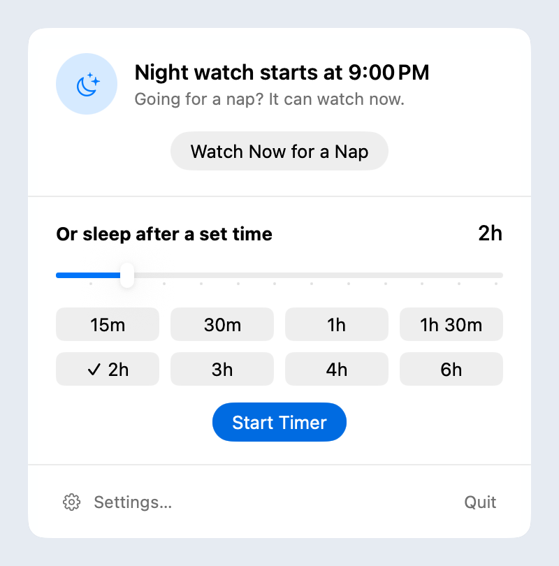
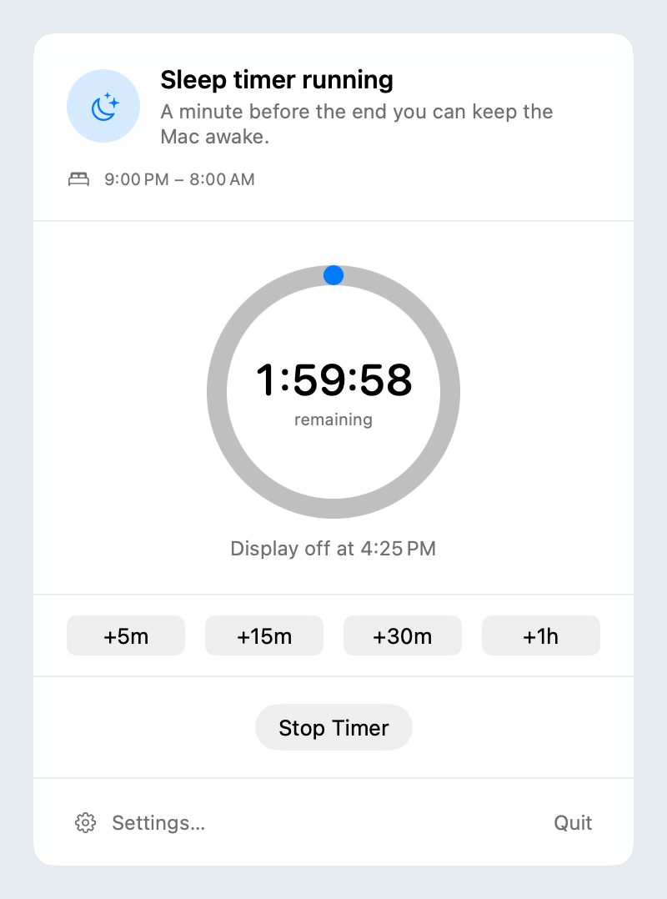
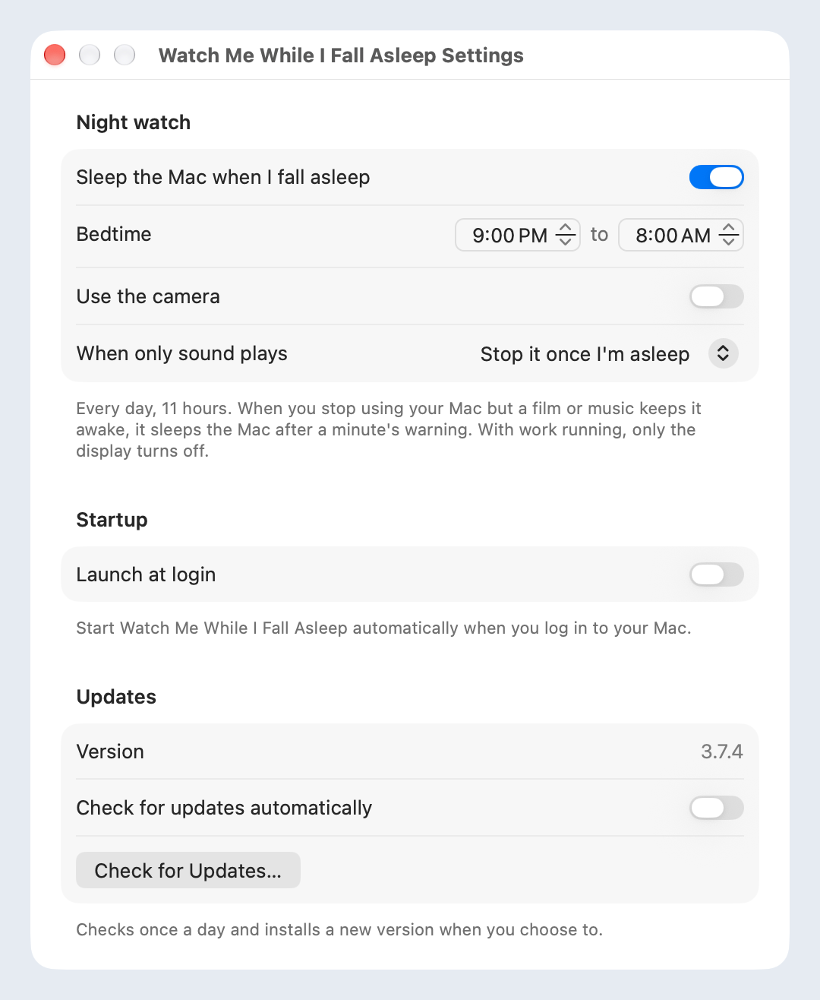

# Watch Me While I Fall Asleep

**Let your Mac fall asleep when you do.**

I have a bad habit of falling asleep to TV shows on my laptop. The show keeps
playing, and my wife ends up having to turn it off for me.

I couldn't find a Mac sleep timer that worked the way I wanted. Maybe I just
missed the right one. So I built a small menu bar app that lets the laptop go
to sleep on its own, with an automatic night watch and optional camera checks
for closed eyes. There's a manual timer too.

I want to sleep better, without leaving my wife to take care of the laptop
after I've fallen asleep.

[**Download the latest release**](https://github.com/wiltodelta/watch-me-sleep/releases/latest)
 · macOS 15+ · Apple silicon

[](https://github.com/wiltodelta/watch-me-sleep/actions/workflows/build.yml)

<p align="center">
  <picture>
    <source media="(prefers-color-scheme: dark)" srcset="screenshots/manual-timer-dark.png">
    
  </picture>
</p>

## How it works

### Let the night watch decide

Choose your bedtime, then watch as usual. The night watch runs from **9 PM to
8 AM** by default. You can set any start and end time, including a daytime
schedule, or click **Watch Now for a Nap** to use it outside those hours.

When media keeps your Mac awake and you haven't touched it for five minutes,
the optional camera takes a short look. Closed eyes start a **five-minute
sleep timer**. If your eyes are open, it checks again later. A timer started
by the camera checks once more in its final minute, and open eyes cancel it.

You can use the night watch without a camera. A quiet Mac gets a timer after
20 minutes without input. With media playing and no usable camera, it asks
whether you're still watching after two hours.

For a podcast, audiobook or white noise, choose whether the sound should stop
once you're asleep or keep playing with the screen off.

Turning off the night watch or ending a nap cancels its automatic timer.
Choosing to keep sound playing cancels it when only sound is playing.
Timers you set by hand keep running.

### Or choose a time yourself

Set a timer for **15 minutes to 12 hours**, or pick one of eight presets.
The countdown appears in the menu bar. Open the panel to add **5, 15, 30 or
60 minutes**, or stop the timer.

<p align="center">
  <picture>
    <source media="(prefers-color-scheme: dark)" srcset="screenshots/active-manual-timer-dark.png">
    
  </picture>
</p>

## Before the Mac goes to sleep

In the final minute, a small countdown appears on every display, including
over full-screen video, while the volume fades out. A manual timer's warning
offers **+30m** and **Sleep Now**. Volume returns when the Mac or its display
wakes.

If you use the mouse or keyboard, a night watch timer cancels immediately.
For a timer you set yourself, input during the final minute postpones sleep
by **30 minutes** instead.

If another process is keeping the Mac awake for work, the timer turns off
only the display. The work keeps running, and the Mac can sleep normally
once that process lets it.

The [user guide](docs/usage.md#night-watch) covers the exact timing, unclear
camera checks and other night watch decisions.

## Install

Requires **macOS 15 or later** and **Apple silicon**. Intel Macs are not
supported. The interface follows your system's appearance, with Liquid Glass
on macOS 26 and later.

1. [Download the latest release](https://github.com/wiltodelta/watch-me-sleep/releases/latest)
   and unzip it.
2. Move **Watch Me While I Fall Asleep.app** to **Applications** and open it.
3. Click the moon in the menu bar and open **Settings…**. Choose your bedtime
   and whether to use the camera. Turn on **Launch at login** if you want the
   app ready each night.

Release builds are signed with a Developer ID and notarized by Apple.
Updates use Sparkle: the app checks daily and installs a new version when
you choose to. Automatic checks can be turned off in Settings.

<p align="center">
  <picture>
    <source media="(prefers-color-scheme: dark)" srcset="screenshots/settings-dark.png">
    
  </picture>
</p>

## Camera and privacy

Camera checks are optional. Turn on **Use the camera** in Settings to grant
access, then use **Camera preview > Show** to check the view from where you
usually watch. The night watch never asks for permission during the night.

**Camera images stay on your Mac. Nothing is recorded or uploaded.**
Frames are analyzed locally with Apple's Vision and Core Image frameworks.
Automatic camera checks run only during bedtime or an active nap. The
Settings preview runs only while you show it.

A dark, incomplete or stalled camera check isn't treated as proof that you're
asleep. An empty frame counts only after the camera has seen a face during the same
stretch without input. Detection can still be imperfect; the
[eye-detection notes](docs/eye-detection.md) explain the method, measurements
and limitations.

There are no accounts, analytics or telemetry. The app's network traffic is
its Sparkle update check.

## Build from source

Use full **Xcode 26 or later** on **macOS 26 or later**. The app uses SwiftPM
and Apple's frameworks, with Sparkle as its only external dependency.

```bash
git clone https://github.com/wiltodelta/watch-me-sleep.git
cd watch-me-sleep
./create-app.sh
open "Watch Me While I Fall Asleep Dev.app"
```

Local builds are named **Watch Me While I Fall Asleep Dev**, with a separate
development bundle identifier and settings.
The build script signs with the team's Developer ID when available and
otherwise uses an ad hoc signature.

- `bash maintain.sh` runs SwiftLint with fixes, tests and a signed bundle
  build. Install SwiftLint with `brew install swiftlint` first.
- `./capture-screenshots.sh` regenerates both screenshot themes with the
  camera off. It needs Accessibility and Screen Recording access and restores
  the development settings afterward. See the [screenshot recipe](docs/screenshots.md).
- [Build and release](docs/build-and-release.md) covers signing,
  notarization, tag-driven releases and Sparkle packaging.
- [UI architecture](docs/ui-architecture.md) describes the native menu bar
  panel, Settings and warning windows.

## Help

See the [user guide](docs/usage.md) for Settings, updates, troubleshooting and
uninstalling. If the menu bar icon is hidden, open the app again from Finder
or Spotlight to reach Settings.

To investigate an unexpected night watch decision, enable the optional
[diagnostics journal](docs/diagnostics.md). It records signals and decisions
without camera images.

## License

[Apache License 2.0](LICENSE).
